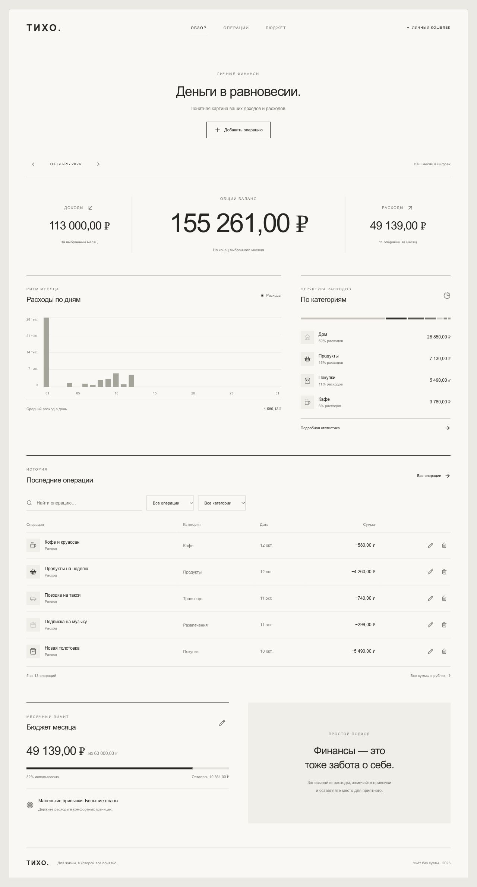

# Тихо — учёт личных расходов

Практическое занятие 2: Docker и Docker Compose. Полноценное приложение на React + Go + PostgreSQL. Интерфейс адаптирован по [референсу Fear of God в Pinterest](https://pin.it/78Irfdn5n): почти белый фон, тонкая внешняя рамка, горизонтальная навигация, центрированный баланс и монохромные графики. Дополнительный визуальный ориентир — [интерфейс Fear of God](https://ixd.prattsi.org/2024/01/design-critique-fear-of-god-shopping-website/), в частности компактное верхнее меню и выразительная центральная типографика.




## Возможности

- Добавление, редактирование и удаление доходов и расходов.
- История с поиском и фильтрами по месяцу, категории и типу.
- Общий баланс на конец выбранного месяца; доходы и расходы за месяц.
- График расходов по дням и распределение по категориям.
- Настраиваемый месячный лимит: одинаковый для всех месяцев.
- Экспорт отфильтрованной истории в CSV для Excel.
- Адаптивная версия для телефона, клавиатурная навигация и проверка введённых данных.
- Данные сохраняются после перезапуска контейнеров.

Это локальное приложение с одним кошельком, без регистрации и связи с банковскими счетами. Первый запуск добавляет вымышленные демонстрационные операции относительно текущей даты PostgreSQL. Все суммы хранятся целыми числами в копейках.

## Запуск

Нужен работающий Docker Desktop с Docker Compose v2. Node.js, Go и PostgreSQL на компьютере для запуска не нужны.

1. Откройте терминал в этой папке.
2. Если `.env` отсутствует, скопируйте `.env.example` в `.env` и задайте свой `DB_PASSWORD`. В подготовленном проекте `.env` уже создан со случайным локальным паролем.
3. Выполните:

```sh
docker compose config -q
docker compose up -d --build
```

Откройте **http://localhost:8080**. Если порт занят, поменяйте `APP_PORT` в `.env` и повторите запуск. Приложение доступно только на этом компьютере (`127.0.0.1`); пароль и `.env` не включаются в образ и должны оставаться вне Git.

```sh
docker compose ps
docker compose logs app
curl http://localhost:8080/api/items
curl http://localhost:8080/api/health
```

Остановка с сохранением данных:

```sh
docker compose down
```

Повторный запуск:

```sh
docker compose up -d
```

`docker compose down -v` удаляет том БД и **все операции**. Эта команда нужна только для намеренного сброса. SQL из `init/` выполняется один раз, при создании пустого тома. Изменение пароля в `.env` не меняет пароль уже созданной БД.

## Структура

```text
.
├── backend/
│   ├── main.go          # HTTP API, PostgreSQL, раздача собранного React
│   ├── main_test.go     # Валидация данных и JSON-запросов
│   ├── go.mod
│   └── go.sum
├── frontend/
│   ├── src/main.jsx     # React: обзор, операции, бюджет, диалоги
│   ├── src/style.css    # Адаптивные стили
│   ├── index.html
│   ├── vite.config.js
│   ├── package.json
│   └── package-lock.json
├── init/01_seed.sql     # Таблицы и демонстрационные записи
├── tests/smoke.py       # Проверка работающего API
├── Dockerfile
├── docker-compose.yml
├── .dockerignore
├── .gitignore
└── .env.example
```

## Как устроен Dockerfile

Три этапа сборки:

1. `frontend`: Node.js устанавливает зафиксированные зависимости через `npm ci` и собирает React с Vite.
2. `builder`: Go скачивает модули до копирования кода (слой зависимостей кэшируется), затем собирает статический бинарник с `CGO_ENABLED=0` и без отладочной информации.
3. `runtime`: distroless содержит только минимальную среду, бинарник и статический frontend. Node, Go-компилятор, исходники и shell сюда не попадают. Пользователь — UID/GID `65532`, не root.

React подходит под задание: после сборки это обычные HTML/CSS/JS, которые раздаёт Go через `http.FileServer`. Отдельный сервер Node или nginx не требуется. `build.context` — корень проекта, потому что образ включает и backend, и frontend. Готовый образ имеет тег `expense-tracker:1.0.0`.

## Как устроен Compose

- `app` и `db` работают в сети `app_net`. Имя `db` разрешается внутренним DNS Docker, поэтому Go использует `DB_HOST=db`, а не `localhost`.
- У PostgreSQL нет опубликованного порта. У приложения опубликован `8080` только на loopback-интерфейсе.
- `pg_isready` проверяет готовность БД, `depends_on: condition: service_healthy` откладывает запуск приложения. Go дополнительно повторяет подключение при старте.
- Именованный том `db_data` сохраняет операции; SQL монтируется read-only.
- Учётные данные берутся из `.env`, который исключён из Git и контекста сборки.
- `restart: unless-stopped` перезапускает контейнеры при сбое.

## API

| Метод | Адрес | Назначение |
|---|---|---|
| GET | `/api/items` | Все операции из PostgreSQL |
| POST | `/api/items` | Добавить операцию |
| PUT | `/api/items/{id}` | Изменить операцию |
| DELETE | `/api/items/{id}` | Удалить операцию |
| GET / PUT | `/api/budget` | Получить / изменить лимит |
| GET | `/api/health` | Проверить доступность БД |

Пример POST/PUT (сумма **в копейках**, 58000 = 580 ₽):

```json
{"name":"Кофе","amount":58000,"kind":"expense","category":"Кафе","date":"2026-10-12"}
```

Расходные категории: Продукты, Кафе, Транспорт, Покупки, Дом, Здоровье, Развлечения, Другое. Доходные: Зарплата, Подработка, Другое.

## Проверки и защита

Проверка API с Python 3 (создаёт отдельную тестовую операцию, изменяет её и удаляет):

```sh
python3 tests/smoke.py
```

Если меняли `APP_PORT`, передайте свой URL: `python3 tests/smoke.py http://localhost:8081`.

Тесты Go при установленном Go:

```sh
cd backend
go test ./...
go vet ./...
```

Тесты Go через Docker, без установки Go на компьютер:

```sh
docker build --target builder -t expense-builder:test .
docker run --rm --entrypoint go expense-builder:test test ./...
```

Проверка размера и пользователя:

```sh
docker image inspect expense-tracker:1.0.0 --format 'Bytes={{.Size}} User={{.Config.User}}'
```

Для проверки отсутствия shell можно выполнить `docker compose exec app /bin/sh`: ожидается ошибка, потому что shell в runtime отсутствует. Это нормально; логи смотрятся командой `docker compose logs app`.

Демонстрация на 5 минут:

1. `docker compose up -d --build` и `docker compose ps`.
2. Открыть страницу, показать обзор и добавить расход.
3. Показать `curl http://localhost:8080/api/items`: запись пришла из БД.
4. Показать Dockerfile, этапы сборки, размер и UID образа.
5. Показать healthcheck, внутреннюю сеть и том; объяснить, почему у БД нет наружного порта.

Для разработки интерфейса вне Docker: в `frontend/` выполнить `npm ci`, затем `npm run dev`. Vite перенаправляет `/api` на Go, работающий по адресу `http://localhost:8080`.
